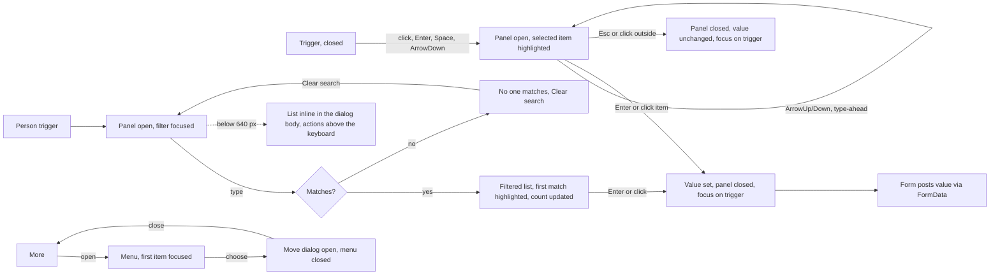

# Design Spec: custom-dropdowns

> **What this is:** The design phase's canonical artefact — produced by `/design` step 5 after two operator approvals: the intent (step 1) before any pixels, and the audit record (step 4) before this file commits. The guards in § 7 become `/ship` acceptance criteria by id.
>
> **Where it lives:** `docs/features/<slug>/DESIGN-SPEC.md` on the story's branch, beside its mockups at `docs/features/<slug>/mockups/<screen>.html` — one self-contained HTML file per screen, ≤ 250 KB, no external asset beyond the render layer's allow-listed font hosts, opening with a provenance comment and carrying a visible synthetic-content marker. Mockups are committed source; renders and screenshots are not (ADR-0002).
>
> **How long it is:** Two pages. A spec that needs more is two surfaces, or a T3 whose shape belongs in DESIGN.md.
>
> **Gate:** `/ship` reads § 7 and cites every guard in its plan; a guard the plan does not cite is a blocking review finding. `/ship` never edits a mockup — a build that proves one wrong amends this spec and regenerates the mockup in the same PR.

---

**Slug:** `custom-dropdowns` (no story id — ad-hoc brief)
**Story:** ad-hoc — replace the OS-drawn dropdowns across the app with one in-app control
**Tier:** T2 — a multi-file component swap across 7 call sites plus two new primitives; no auth, PII, deletion or migration (the person picker's data scope is unchanged)
**Surface:** dropdown controls across the app — Select (short fixed lists), Combobox (person picker), the asset page's "More" lifecycle menu
**Mode:** Operate
**Dials:** V3 / M3 / D5 — source: taste §1.A "redesign - preserve"
**Scope row:** Operate
**Mockups:** `mockups/select.html`, `mockups/combobox.html`, `mockups/menu.html`
**Stack observed:** taste f7493a5 · Impeccable 4.5.2, engine 0.1.14 (schemas 1/— : product stamp 1, no `.impeccable/design.json` sidecar) · frontend-design@claude-plugins-official 1.1.1 — registry comparison skipped (the project's CLAUDE.md names no design-stack registry)
**Date:** `2026-11-18T22:14:48Z`
**Status:** Committed

## 1. Intent

> "Reading this as: a form-control consistency pass on an internal asset register, for IT admins and procurement staff working in bursts and field staff on phones, with a quiet, precise, data-first language, leaning toward shadcn/ui on Radix primitives (the project's ruling in `docs/DESIGN-SYSTEM.md` §1)." — product UI, out of taste §13 scope; applying §0, §1, §2.A and the cross-cutting guardrails only, scope row Operate applied.

- **Audience and job:** writers (`ADMIN_IT`, `PROCUREMENT`) picking a status, category, site, condition, role or person while recording a delivery, an assignment or a repair; every role filtering the register, including `STAFF_RO` on a phone.
- **Feeling and references:** quiet, precise, consistent. Reference: the app's own "More" panel (`bg-popover rounded-lg border p-1 shadow-lg`), which becomes the one popup look.
- **Dials:** V3 / M3 / D5 — "redesign - preserve": variance and density match the incumbent app, motion is the incumbent's +1 (a 150–200 ms open). Not "trust-first": nothing here changes the app's posture, only one control's consistency.
- **Established world:** inherits the incumbent surface "Asset Register" (no DESIGN.md — not quoted from a record); tokens from `src/app/globals.css`, typography from `docs/DESIGN-SYSTEM.md` §7.
- **Discovery (Impeccable shape, Phases 1 and 3):**
  - Outcome and proof: every dropdown opens the same in-app panel, with one trigger height, one width rule, one focus ring, one selected tick and one empty-choice vocabulary, in light and dark. The person picker filters by name or employee ref. Forms still post real `FormData`; no server action changes.
  - States and ranges: 2–4 options (status, destination, role, condition) up to ~70 people at the reference scale; option labels up to ~45 characters ("In stock (already on the shelf — needs a tag)"); people with and without an employee ref.
  - Boundaries — untouched: option labels other than the empty choices; server actions and their validation; `personSelectFor` and what the person picker fetches; the role-select-plus-Apply layout on `/admin/users`; the theme toggle (stays a cycle button).
  - Constraints: popups render above Radix Dialogs and inside their focus trap (5 of 13 selects live in dialogs); never clipped by a scrolling ancestor; one control height for **every** form control, 36 px and 44 px on a coarse pointer (operator decision after the critique, 2026-11-18 — Input and Button included, not only the dropdowns); reduced-motion respected; custom on every device (operator decision, 2026-11-18, re-confirmed after the critique — accepted cost: inert for the seconds before hydration on a slow connection, and phones lose the OS picker; the plan measures the added client JS against PRODUCT.md's payload constraint and reports it in the PR); the "More" menu is rebuilt in this story (operator decision, same date).
  - Dependencies to verify at build (taste §3.F): `@radix-ui/react-select`, `@radix-ui/react-popover`, `@radix-ui/react-dropdown-menu`, and `cmdk` (shadcn `Command`) for the person picker's filtering and listbox semantics — a Popover with a hand-written filter list is the hand-rolled listbox `docs/DESIGN-SYSTEM.md` §1 rejected.

Approved by the operator on 2026-11-18 before any pixels.

## 2. Flows

States per screen: Select — rest, hover, focus, open, highlighted, selected, disabled/pending, invalid. Combobox — the same, plus filtering, no-match, and empty list. Menu — closed, open, item highlighted, dialog open.

## 3. Screens and layout

### Select (`mockups/select.html`)

- **Composition:** the trigger fills its field wrapper; the wrapper's width comes from layout (form column, filter slot), never from the longest option. Chevron-down at the trailing edge in muted foreground. The panel uses Radix `position="popper"` (not shadcn's `item-aligned` default): at least the trigger's width, 4 px below, flipping above near the viewport edge, scrolling past 288 px. A long option wraps inside the panel; the trigger truncates it with an ellipsis. The empty choice sits first in muted text, separated from real options by a hairline. The selected option carries a trailing check. Keyboard: Enter/Space/↓ open, ↑↓ move, letters type-ahead, Enter chooses, Esc closes unchanged.
- **Breakpoints:** ≥ 640 the register filter slots are a fixed 176 px each beside a 288 px search (one row when the content column is ≥ ~830 px, wrapping below that); < 640 every control stacks full width. Form grids keep their existing 1- and 2-column layouts. Coarse pointer: every control and row 44 px.
- **Hierarchy:** label, current value, chevron. A placeholder ("Choose a …") is muted and is never an option in the list.

### Combobox (`mockups/combobox.html`)

- **Composition:** chevrons-up-down trigger — the up-down chevron marks a searchable picker, the plain chevron a fixed list. The panel opens with a search field (magnifier, "Search by name or employee ref") above the list; the search field owns `role="combobox"` and drives the listbox (cmdk). Each row is the name, plus the employee ref in mono, right-aligned, when one exists; when a name repeats in the list, a ref-less row shows a muted "No ref" so two holders never look identical. Matched substrings are bold and underlined in place. A polite live count ("4 of 71 people") sits under the list. No match: "No one matches "<query>"." with a Clear search action. Pressing Assign with nobody chosen shows the invalid trigger and "Choose a person."
- **Breakpoints:** ≥ 640 a floating panel the trigger's width. < 640 the search field and list open **inline in the dialog body** (operator decision after the critique, 2026-11-18): the list height is capped to the visible viewport (`min(264px, 40dvh)`), so Cancel/Assign stay reachable above the soft keyboard; choosing collapses the list back to the chosen trigger.
- **Hierarchy:** filter, then name, then ref.

### Menu (`mockups/menu.html`)

- **Composition:** "More" gains a chevron-down. Its panel is the Select panel (same surface, radius, inset, row height, highlight), left-aligned to the trigger, min 192 px. "Retire asset…" stays last (`MOVE_PRIORITY`) behind a separator, because it ends the lifecycle.
- **Breakpoints:** unchanged lifecycle row; the panel flips when near the edge.
- **Hierarchy:** the primary move stays a filled button; secondary moves live one step away, as today.

## 4. States matrix

| Screen   | Empty / none                                                                                                 | Pending (form saving)                               | Error                                                                                                                         | Success                                   | Open                                                                | Confirmation                                                                                                                                           |
| -------- | ------------------------------------------------------------------------------------------------------------ | --------------------------------------------------- | ----------------------------------------------------------------------------------------------------------------------------- | ----------------------------------------- | ------------------------------------------------------------------- | ------------------------------------------------------------------------------------------------------------------------------------------------------ |
| Select   | Empty choice per § 7 G5 vocabulary; a required field with no default shows its "Choose a …" placeholder      | Trigger disabled at 50 % opacity, panel cannot open | Required and empty on submit: destructive border and ring, `aria-invalid`, inline message under the field (no browser bubble) | Value shown in the trigger; form posts it | Panel with selected tick and highlight                              | n/a                                                                                                                                                    |
| Combobox | `people.length === 0`: the existing "There are no staff records…" paragraph replaces the control (unchanged) | As Select                                           | As Select, message "Choose a person."; no match: "No one matches "<query>"." plus Clear search                                | Name and ref in the trigger               | Filter focused, list, live count; inline in the dialog below 640 px | n/a                                                                                                                                                    |
| Menu     | Not rendered when a status offers no secondary moves (unchanged)                                             | n/a                                                 | n/a                                                                                                                           | The chosen move's dialog opens            | First item focused                                                  | The destructive moves keep their existing confirmation dialogs ("Retire this asset?") — modelled as a state of the menu's flow, unchanged by this spec |

## 5. Tokens touched

- `--popover`, `--popover-foreground`, `--accent`, `--accent-foreground`, `--border`, `--input`, `--ring`, `--muted-foreground`, `--destructive`, `--radius` (`rounded-lg` panel, `rounded-sm` rows, `rounded-md` trigger) — reused as-is; source of truth `src/app/globals.css`.
- No new tokens. Two composition rules are new: (1) secondary text inside a highlighted row takes `--accent-foreground`, because `--muted-foreground` on `--accent` measures 4.3:1 in light (below AA); (2) one control height for every form control — 36 px, 44 px under `@media (pointer: coarse)` (Tailwind v4's `pointer-coarse:` variant) — applied in the `Input`, `Button`, Select, Combobox and menu primitives rather than per call site.
- `--st-stock`, `--st-stock-bg` — reused as-is in `menu.html`'s context chrome only (the status chip, measured 5.39:1 light, 7.02:1 dark).

## 6. Motion

- The panel fades and scales from 0.96 to 1 at its anchored edge, 150 ms ease-out on open and 100 ms on close (Radix `data-state` animation classes, as shadcn ships). Nothing else moves; the highlight is instant. Reduced-motion alternative: the panel appears and disappears with no transform and no fade.

## 7. Guards

- [ ] **G1** — No native `<select>` element is rendered as a visible, interactive control anywhere in `src/app` or `src/components`; every dropdown is the shared Select, Combobox or Menu. Fails when someone adds or keeps a raw `<select>` (or the old `select.tsx` primitive) at any call site.
- [ ] **G2** — Every Select and Combobox submits its value through `FormData` under the same `name` as today, so every server action receives byte-identical input. Fails when someone drops the hidden form input, renames a field, or moves a value into client state only.
- [ ] **G3** — A Select or Combobox trigger is always the full width of its wrapper; no trigger width depends on its options. Fails when someone puts `w-fit` (or an option-length-driven width) back on a trigger.
- [ ] **G4** — On a coarse pointer every form control is at least 44 px tall: `Input`, `Button`, Select and Combobox triggers, the picker's search field, and every option and menu row. Fails when someone fixes a control or row height in px without the coarse-pointer variant, or applies it to the dropdowns alone.
- [ ] **G5** — Empty choices use exactly four phrases, each with one meaning: "Any <noun>" (filter with no constraint — the register's Category and Site filters), "Not recorded" (optional attribute left blank — Condition, Site; the asset form's "Unassigned" becomes "Not recorded"), "Leave unchanged" (repair dialogs), and a "Choose a <noun>" placeholder that is never an option (required, no default). Fails when someone ships "All", "Unassigned", "None" or a disabled placeholder option.
- [ ] **G6** — The asset form's required Category starts empty on create and cannot be submitted empty; nothing is preselected for the operator. Edit still opens on the asset's category. Fails when someone restores a first-option default.
- [ ] **G7** — The person picker filters on a case-insensitive substring of name OR employee ref, reports the visible count politely to assistive tech, and shows "No one matches "<query>"." with a Clear search action when empty. A person without an employee ref shows nothing in the ref column, except that when their name appears more than once in the visible list the ref-less row shows a muted "No ref". Fails when someone filters on name only, prefix-matches, reintroduces "no employee ref" on every row, or lets two same-named, ref-less rows render identically.
- [ ] **G8** — The person picker is fed exactly the `people` prop it receives today; no new query, field or role reaches it. Fails when someone fetches or widens person data for the Combobox (§ `STAFF_RO`-sees-no-person-data; `personSelectFor` is untouched).
- [ ] **G9** — A popup opened inside a Radix Dialog renders above it, keeps focus inside the dialog's trap, and Escape closes the popup first without closing the dialog. Fails when someone portals the panel outside the dialog's layer or lets Escape propagate.
- [ ] **G10** — Escape and outside click close the "More" menu and return focus to its trigger; choosing an item opens that move's dialog, and closing the dialog returns focus to "More". Fails when someone nests the dialog inside the menu content so it unmounts when the menu closes.
- [ ] **G11** — The moves a status offers stay assertable in tests: the AM-03 lifecycle tests keep asserting which moves each status renders, adapted to open the menu first, and keep failing when a move is wrongly offered. Fails when someone deletes or weakens those assertions to make the menu change pass.
- [ ] **G12** — Secondary text in a highlighted row (employee ref, a muted empty choice) meets 4.5:1 in both themes. Fails when someone leaves `--muted-foreground` on the `--accent` fill.
- [ ] **G13** — A required Select or Combobox left empty shows the app's invalid state and inline message, never a browser validation bubble anchored to a hidden element. Fails when someone relies on native `required` on the hidden form control for the error UI.
- [ ] **G14** — With `prefers-reduced-motion: reduce` the panel opens and closes without transform or fade. Fails when someone adds an animation without the reduced-motion variant.
- [ ] **G15** — An empty choice ("Any …", "Not recorded", "Leave unchanged") reaches the server exactly as today's empty `<option value="">` does, and an optional column it writes lands as `NULL`, never `''`. Radix `Select.Item` rejects `value=""`, so the empty choice carries a sentinel that is mapped back at the form boundary. Fails when someone lets the sentinel string reach a server action, or writes `''` where today's path writes `NULL` (the `Asset.tag` / `Person.email` trap in CLAUDE.md).
- [ ] **G16** — Below 640 px the person picker renders its search field and list inline in the dialog body, with the list height capped to the visible viewport, so Cancel and Assign stay reachable with the soft keyboard up. Fails when someone ships the floating panel at phone width or lets the list push the actions off-screen.
- [ ] **G17** — Select panels use `position="popper"`: below the trigger, at least its width, flipping near the viewport edge. Fails when someone keeps shadcn's `item-aligned` default, which overlays the trigger and breaks the mockup's anchoring.
- [ ] **G18** — The person picker's filtering and listbox semantics come from `cmdk` (shadcn `Command`): the search field owns `role="combobox"`, `aria-controls` and `aria-activedescendant`, and arrow keys move the highlight without leaving the field. Fails when someone hand-writes the listbox or puts the combobox role on the trigger button.

## 8. Audit record

| Step     | Layer                     | Version observed              | Result                                                                                                                                                                                                                                                                                                                                                                                                                                                                                                                                          |
| -------- | ------------------------- | ----------------------------- | ----------------------------------------------------------------------------------------------------------------------------------------------------------------------------------------------------------------------------------------------------------------------------------------------------------------------------------------------------------------------------------------------------------------------------------------------------------------------------------------------------------------------------------------------- |
| 1 Intent | taste                     | f7493a5                       | Design Read; dials from §1.A "redesign - preserve"                                                                                                                                                                                                                                                                                                                                                                                                                                                                                              |
| 1 Intent | Impeccable shape          | 4.5.2                         | Phases 1 and 3 (Phase 1's question round replaced by two operator decisions: custom on every device, "More" in scope)                                                                                                                                                                                                                                                                                                                                                                                                                           |
| 3 Mockup | frontend-design           | claude-plugins-official 1.1.1 | Installed; mockups built on the project's own tokens and shadcn anatomy, not a new aesthetic                                                                                                                                                                                                                                                                                                                                                                                                                                                    |
| 3 Mockup | Impeccable craft floor    | 4.5.2                         | Applied via the scoped audit below                                                                                                                                                                                                                                                                                                                                                                                                                                                                                                              |
| 4 Audit  | Impeccable critique       | 4.5.2                         | Method: dual-agent (A design review · B detector and browser evidence). 27/40, P0 0 · P1 2 · P2 3; snapshot `.impeccable/critique/2026-11-18T22-25-46Z__docs-features-custom-dropdowns-mockups.md`. Browser overlay not used: `live-server` injection skipped, prohibited by the `/design` gate; B measured with read-only DOM evaluation instead                                                                                                                                                                                               |
| 4 Audit  | Impeccable detector       | 4.5.2 (engine 0.1.14)         | No DEGRADED banner. Final bytes: `overused-font` only (select 1, combobox 2, menu 2), waived below; every other rule clean                                                                                                                                                                                                                                                                                                                                                                                                                      |
| 4 Audit  | Impeccable audit (scoped) | 4.5.2                         | Contrast: all text ≥ 4.5:1 both themes (light muted 4.73:1; chip 5.39 / 7.02); light focus ring ~2.6:1, waived below. Structure: labelled triggers, heading order fixed, listbox/menu roles. Keyboard and focus intent drawn for all three. Touch: 44 px measured at 390 on every control and row. Breakpoints 1280 and 390: no horizontal overflow, panels inside the viewport. Tokens: `globals.css` only. Full audit deferred to implementation (performance and the client-JS budget, theming in the running app, implementation integrity) |
| 4 Audit  | taste pre-flight          | f7493a5                       | out of scope by §13 — scope row Operate applied                                                                                                                                                                                                                                                                                                                                                                                                                                                                                                 |

Findings:

- **Impeccable detector/low-contrast** — fixed in `combobox.html`, `select.html` (secondary text in a highlighted row takes `--accent-foreground`; G12)
- **Impeccable detector/cramped-padding** — fixed in `combobox.html` (search row padded, not fixed-height)
- **Impeccable detector/skipped-heading** — fixed in `menu.html` (asset tag is the page's h2)
- **Impeccable detector/flat-type-hierarchy** — fixed in `menu.html` (same change)
- **Impeccable detector/overused-font** — waived: Geist and Geist Mono are the product's own typefaces (`src/app/layout.tsx`, `docs/DESIGN-SYSTEM.md` §7) and the dials are "redesign - preserve"; changing the face is not this story
- **Impeccable critique/P1 phone assign flow undrawn** — fixed in `combobox.html` (inline list below 640 px, 44 px rows; G16)
- **Impeccable critique/P1 inert before hydration** — waived: operator decision 2026-11-18, re-confirmed after this critique; the cost is recorded in § 1 and the plan measures the added client JS
- **Impeccable critique/P2 picker has no required state or no-match recovery** — fixed in `combobox.html` (G13, G7)
- **Impeccable critique/P2 same-name people indistinguishable** — fixed in `combobox.html` ("No ref" on a repeated name; G7)
- **Impeccable critique/P2 44 px on the Select only** — fixed in all three mockups (one control-height rule; G4)
- **Impeccable critique/combobox role on the trigger** — fixed in `combobox.html` (search field owns it; G18)
- **Impeccable critique/Popover + filter is a hand-rolled listbox** — fixed in this spec (`cmdk` dependency; G18)
- **Impeccable critique/`item-aligned` vs popper unnamed** — fixed in this spec (G17)
- **Impeccable critique/Radix rejects `value=""`** — fixed in this spec (G15)
- **Impeccable critique/chevron rule unstated** — fixed in `combobox.html` and § 3
- **Impeccable critique/long options in fixed filter slots** — fixed in `select.html` (options wrap in the panel, trigger truncates)
- **Impeccable critique/reviewer-note hint copy** — fixed in `select.html` (removed)
- **Impeccable critique/Retire not separated** — fixed in `menu.html`
- **Impeccable critique/light frames incomplete** — fixed in all three (both themes stamped from one frame template)
- **Impeccable critique/status chip without dot** — fixed in `menu.html`
- **Impeccable critique/kbd cells stretch** — fixed in `menu.html`
- **Impeccable audit/focus ring ~2.6:1 in light (WCAG 1.4.11)** — waived: the inherited `--ring` token every input and button already uses; fixing one control's ring would break the consistency this story exists for. Tracked in § 9
- **Impeccable critique/dark hover near-invisible** — waived: the incumbent `dark:hover:bg-input/50` every input uses; preserve dials
- **taste/§9.G em-dash** — no breach: the only em dashes are the shipped "Assign this asset" description, carried as is
- **taste/§6.C and §8 themes** — not waived: the product ships light and dark, and every mockup draws both

Approved by the operator on 2026-11-18.

## 9. Out of scope

- The theme toggle (stays a three-state cycle button, `src/components/theme-toggle.tsx`).
- Date inputs (`type=date`) — also OS-drawn, but a date picker is a separate control and a separate story.
- A server-side people search. The picker filters the list the page already receives; a paginated search belongs to a story that changes what is fetched, and would need a DPA-note review.
- Pre-hydration fallback (a server-rendered native select swapped after hydration) — declined by the operator on 2026-11-18, and again after the critique, in favour of one control everywhere; revisit if field use on slow data proves it.
- The light `--ring` focus indicator at ~2.6:1 (below WCAG 1.4.11's 3:1) — an app-wide token issue shared by every input and button; a token story, not this one.
- Whether "More" (at most two items) should be a menu at all, and whether the person picker should rank this asset's likely holder first — critique questions, left open; the operator kept "More" in scope as a menu.
